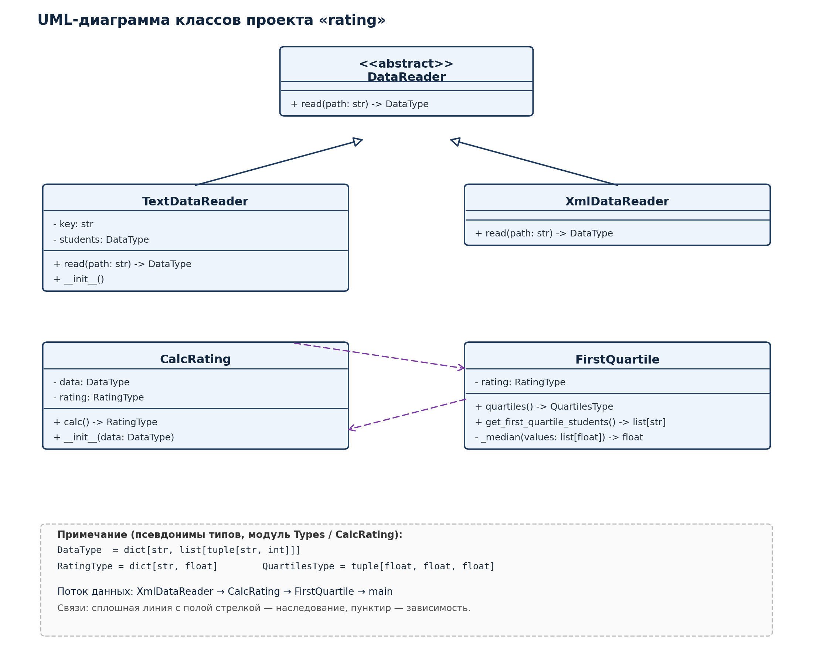

# Лабораторная работа № 1

**Дисциплина:** Технологии программирования и инструментальные средства
разработки систем искусственного интеллекта
**Направление:** 09.04.01 «Информатика и вычислительная техника»
**Студент:** Жаравин Николай Сергеевич, группа САПР-1.4
**Вариант:** 5 (формат входного файла — XML; расчётная процедура — вывод
студентов, чей рейтинг попадает в первую квартиль распределения).

## Постановка задачи

Проект **rating** рассчитывает средний рейтинг студентов по дисциплинам.
Список студентов и полученных ими оценок хранится во входном файле. По
индивидуальному заданию варианта № 5 необходимо:

1. выбрать лицензию и добавить файл лицензии (`LICENSE`, MIT);
2. добавить файл `.gitignore`;
3. реализовать нового наследника класса `DataReader`, читающего данные
   из файла формата **XML** (`XmlDataReader`), и покрыть его тестами;
4. реализовать класс, вычисляющий заданную характеристику студентов —
   вывод студентов, чей рейтинг попадает в **первую квартиль**
   распределения (`FirstQuartile`), и покрыть его тестами;
5. составить UML-диаграмму классов;
6. проанализировать результаты и сделать выводы.

## Краткое описание проекта

Программа на вход получает путь к XML-файлу с оценками студентов,
вычисляет для каждого студента средний балл (рейтинг) и выводит список
студентов, средний рейтинг которых попадает в первую квартиль всего
распределения рейтингов.

Пример строки рейтинга: студент «Абрамов Петр Сергеевич» — математика 80,
русский язык 76, программирование 100 → средний рейтинг 85.33.

## Используемые языки, библиотеки и технологии

* **Python 3.10** — язык реализации;
* стандартная библиотека: `argparse`, `abc`, `xml.etree.ElementTree`;
* **pytest** — модульное тестирование;
* **pycodestyle** — проверка соответствия стилю PEP 8;
* **Git** — распределённая система контроля версий;
* **GitHub Actions** — инструмент CI/CD для автоматического запуска
  линтера и тестов при каждом push.

## Структура проекта

```
rating
├── .github
│   └── workflows
│       └── github-actions-testing.yml   # конфигурация CI
├── data
│   ├── data.xml                         # входные данные (XML)
│   └── data.txt                         # входные данные (текстовый формат)
├── docs
│   └── uml.png                          # UML-диаграмма классов
├── src
│   ├── CalcRating.py                    # расчёт среднего рейтинга
│   ├── DataReader.py                    # абстрактный базовый класс
│   ├── TextDataReader.py                # чтение .txt
│   ├── XmlDataReader.py                 # чтение .xml  (новый класс, вар. 5)
│   ├── FirstQuartile.py                 # первая квартиль (новый класс, вар. 5)
│   ├── Types.py                         # псевдонимы типов (Type Hints)
│   └── main.py                          # точка входа
├── test
│   ├── test_CalcRating.py
│   ├── test_FirstQuartile.py
│   ├── test_TextDataReader.py
│   ├── test_XmlDataReader.py
│   └── test_main.py
├── .gitignore
├── LICENSE
├── README.md
└── requirements.txt
```

## Формат входного файла XML

Имена XML-элементов не могут содержать пробелы, поэтому вместо
некорректной записи `<Иванов Иван Иванович>` используется атрибут `name`:

```xml
<?xml version="1.0" encoding="UTF-8"?>
<root>
  <student name="Иванов Иван Иванович">
    <subject name="математика" score="91"/>
    <subject name="химия" score="100"/>
  </student>
  <student name="Петров Петр Петрович">
    <subject name="русский язык" score="87"/>
    <subject name="литература" score="78"/>
  </student>
</root>
```

## Новые классы (вариант 5)

* **`XmlDataReader`** (наследник `DataReader`) — читает XML-файл с помощью
  `xml.etree.ElementTree` и возвращает словарь `DataType`
  (`{ФИО: [(дисциплина, балл), ...]}`).
* **`FirstQuartile`** — по словарю рейтингов (`RatingType`) вычисляет
  квартили распределения и возвращает список студентов, чей рейтинг
  попадает в первую квартиль. Квартили считаются методом «шарниров»
  (Tukey's hinges): `Q2` — медиана всего распределения, `Q1` — медиана
  нижней половины, `Q3` — медиана верхней половины. В первую квартиль
  включаются студенты с рейтингом `rating <= Q1`.

## UML-диаграмма классов



Основные связи:

* `TextDataReader` и `XmlDataReader` наследуют `DataReader`;
* `FirstQuartile` зависит от типа `RatingType`, определённого в
  `CalcRating`;
* поток данных: `XmlDataReader → CalcRating → FirstQuartile → main`.

## Запуск и проверка

```bash
# 1. Создание и активация окружения (пример для Anaconda)
conda create -n tplab1-env python=3.10
conda activate tplab1-env

# 2. Установка зависимостей
pip install -r requirements.txt

# 3. Проверка стиля PEP 8
pycodestyle src test

# 4. Переменная окружения для поиска модулей
$env:PYTHONPATH = "./:./src"      # Linux/macOS
# set PYTHONPATH=./;./src         # Windows

# 5. Запуск тестов
pytest test

# 6. Запуск программы
python ./src/main.py -p ./data/data.xml
```

Пример вывода программы:

```
First quartile students:  ['Сидоров Алексей Петрович',
                           'Морозов Никита Игоревич',
                           'Романова Ольга Дмитриевна']
```

## Непрерывная интеграция (CI)

Файл `.github/workflows/github-actions-testing.yml` описывает процесс
непрерывной интеграции. При каждом `push` в ветку `main` GitHub Actions:

1. разворачивает виртуальную машину `ubuntu-latest`;
2. устанавливает Python 3.10 и зависимости из `requirements.txt`;
3. запускает линтер `pycodestyle src test`;
4. запускает тесты `pytest test` с заданным `PYTHONPATH`.

При успешном прохождении у коммита появляется зелёная галочка, при ошибке —
красный крест.

## Выводы

В ходе работы были получены навыки:

* работы с распределённой системой контроля версий Git (инициализация
  репозитория, ветвление, коммиты, слияние, работа с удалённым
  репозиторием GitHub);
* написания объектно-ориентированного кода на Python и модульных тестов к
  нему средствами `pytest`;
* оформления кода в соответствии со стандартом PEP 8 (линтер
  `pycodestyle`);
* настройки процесса непрерывной интеграции с помощью GitHub Actions.

Все 12 модульных тестов проходят, линтер ошибок не находит.
